# Contingência — roteiro visual da demonstração

> Use **somente** se o sistema não executar no equipamento da mostra. Não substitui o MVP (`java Tarefas.java run`).
> As miniaturas dos vídeos aparecem como um quadro cinza "captura offline" porque as capturas foram feitas sem internet.
> Vídeo curto do fluxo (≈15 s, acelerado): [`demonstracao.mp4`](demonstracao.mp4).

| # | Passo | Imagem |
|---|---|---|
| 1 | Home como capa de jornal |  |
| 2 | Editoria (paginação de 6 em 6) | 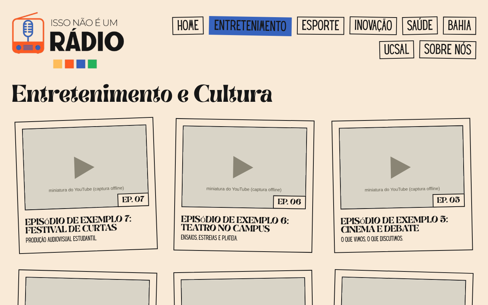 |
| 3 | Seção UCSAL |  |
| 4 | Login do painel (credenciais fictícias) | 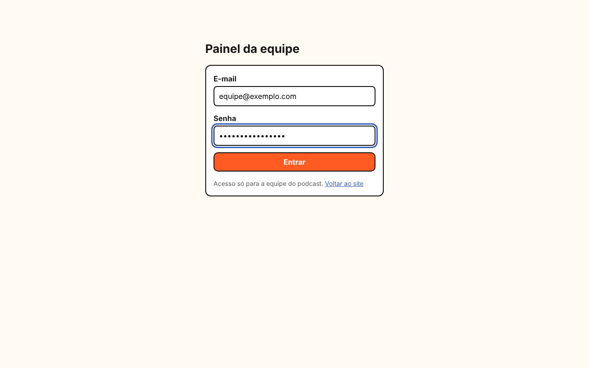 |
| 5 | Lista de matérias | 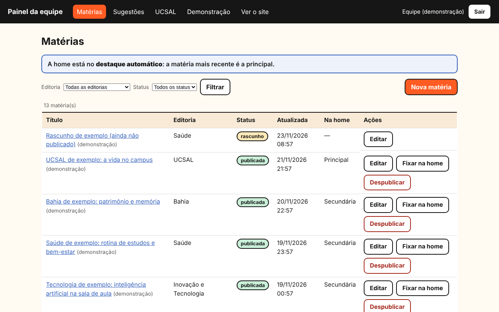 |
| 6 | Publicar com campos faltando: erros junto de cada campo | 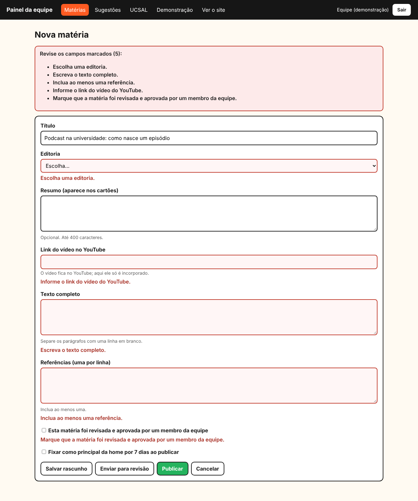 |
| 7 | Formulário completo | 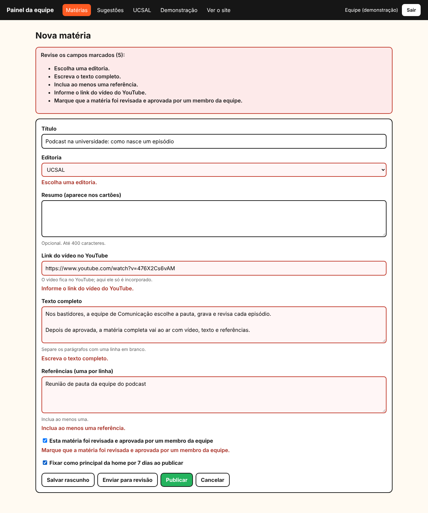 |
| 8 | Publicada (aviso verde) | 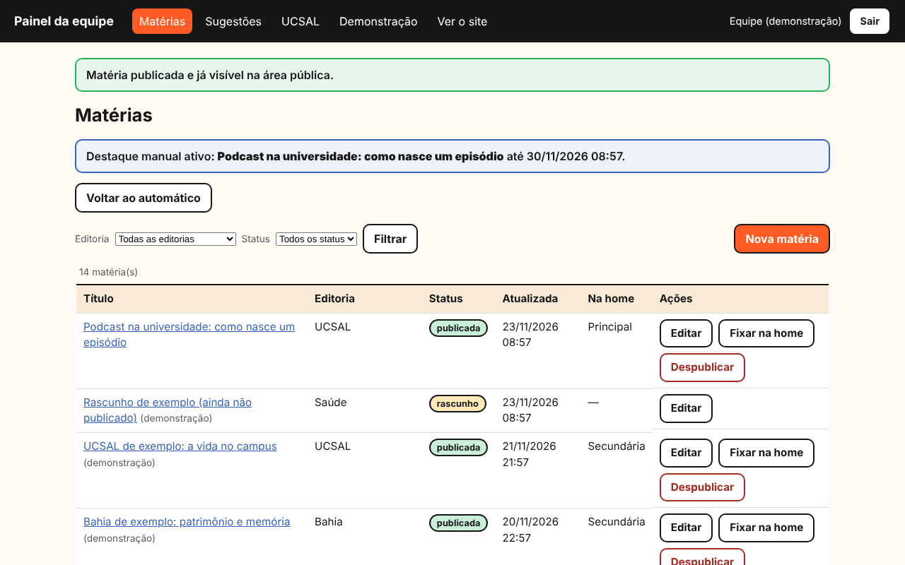 |
| 9 | Home com a nova matéria em destaque | 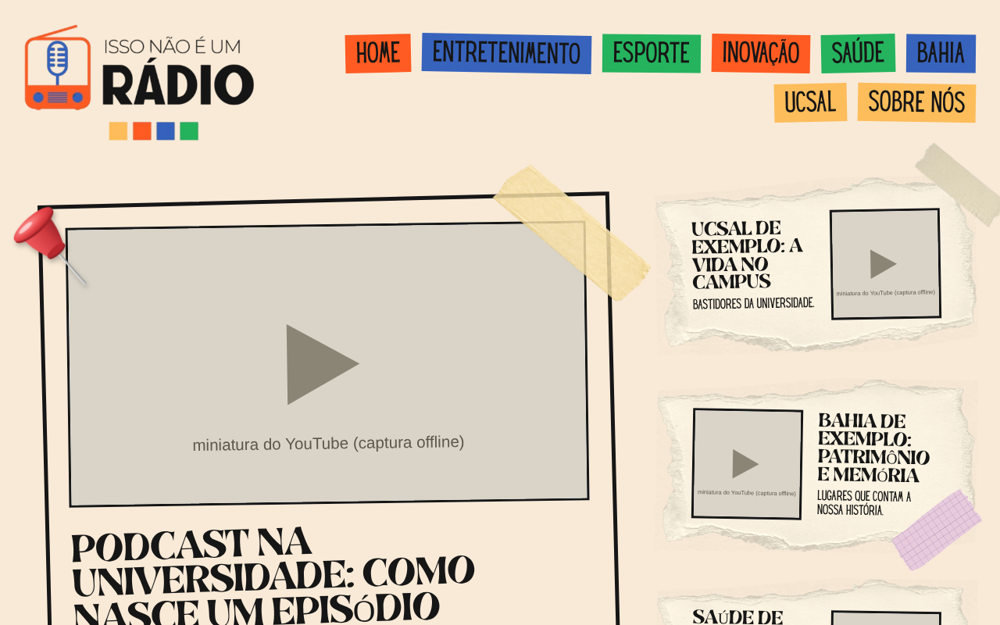 |
| 10 | Página da matéria | 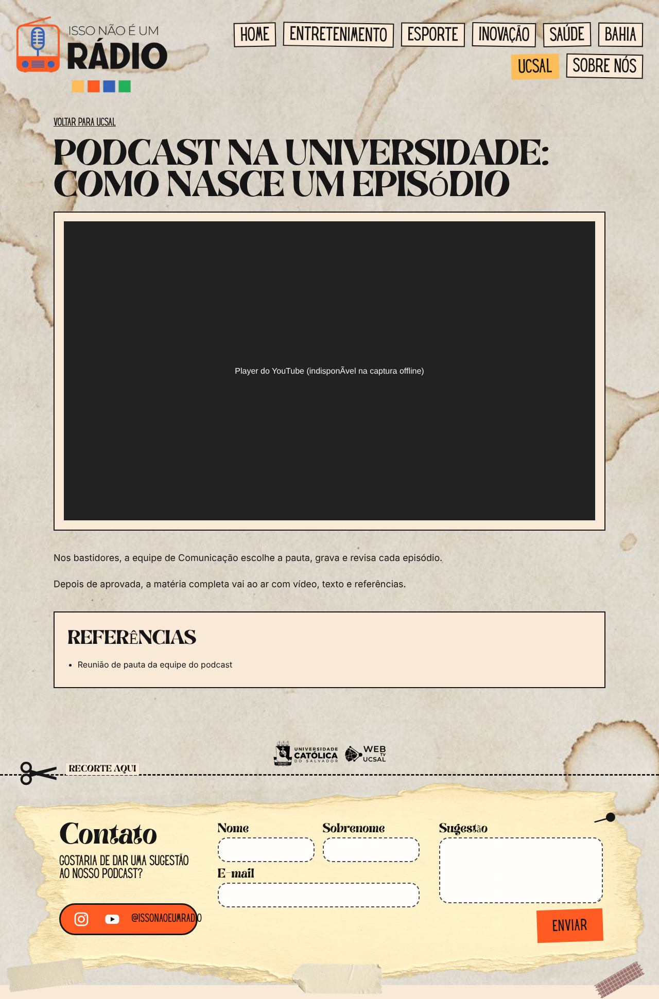 |
| 11 | Demonstração: falha de gravação ligada | 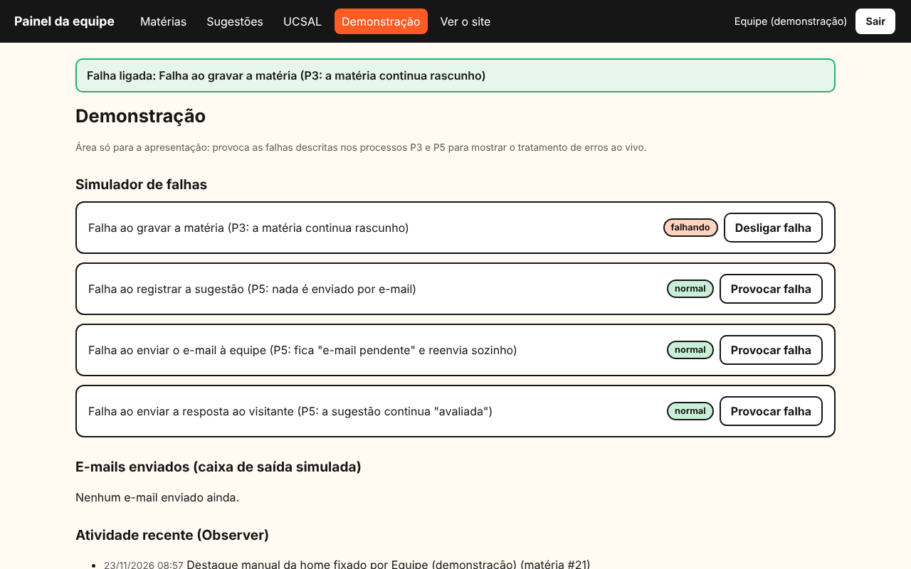 |
| 12 | Falha ao gravar: erro claro, matéria não vai ao ar | 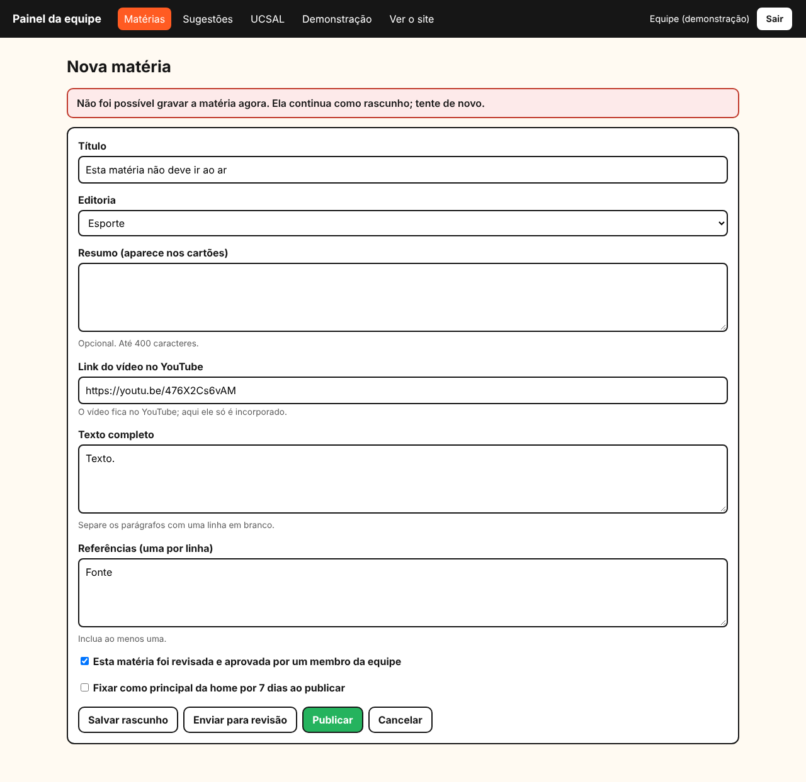 |
| 13 | Home intacta depois da falha |  |
| 14 | Visitante envia sugestão (continua confirmado mesmo com e-mail falhando) | 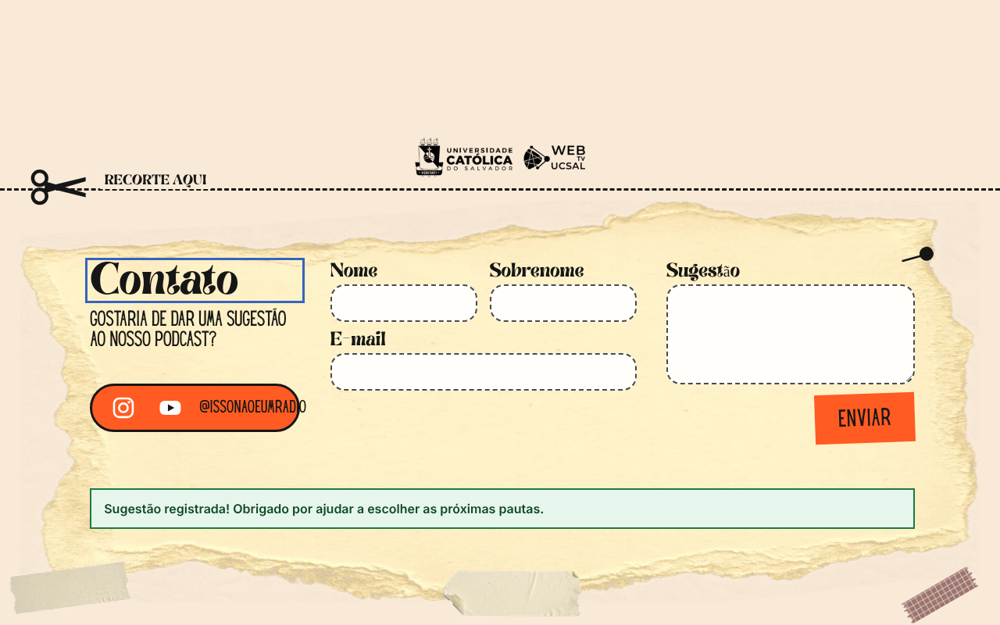 |
| 15 | Painel: "e-mail pendente" | 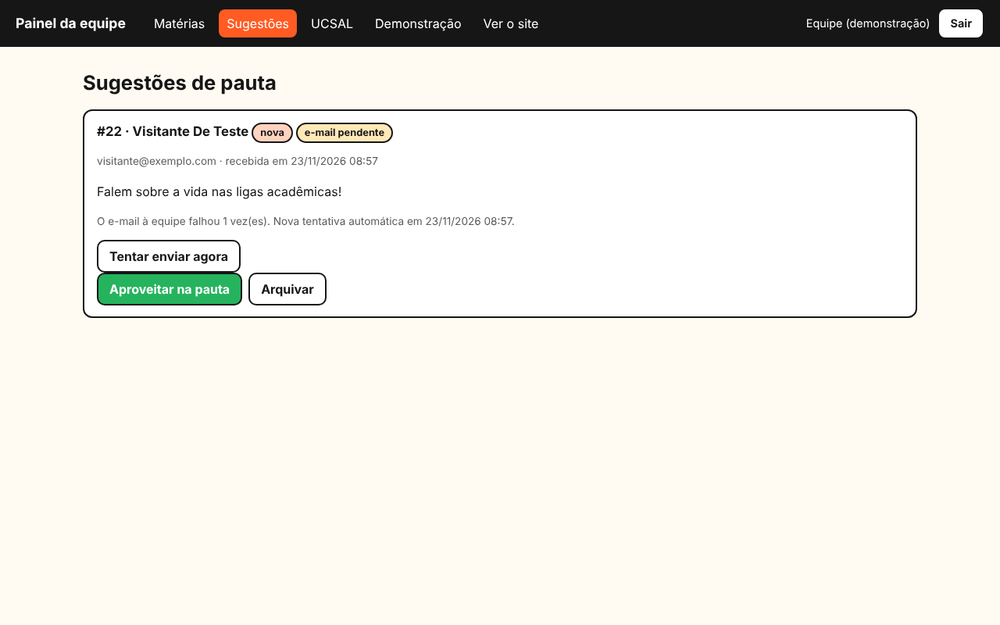 |
| 16 | Reenvio concluído | 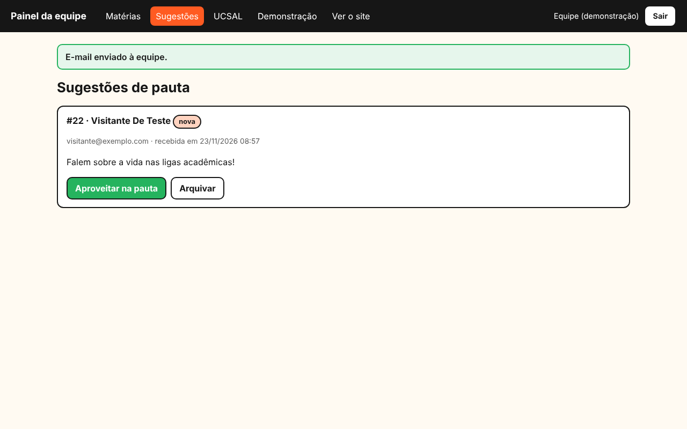 |
| 17 | Tela de demonstração (eventos, proxy, rotas por reflexão) | 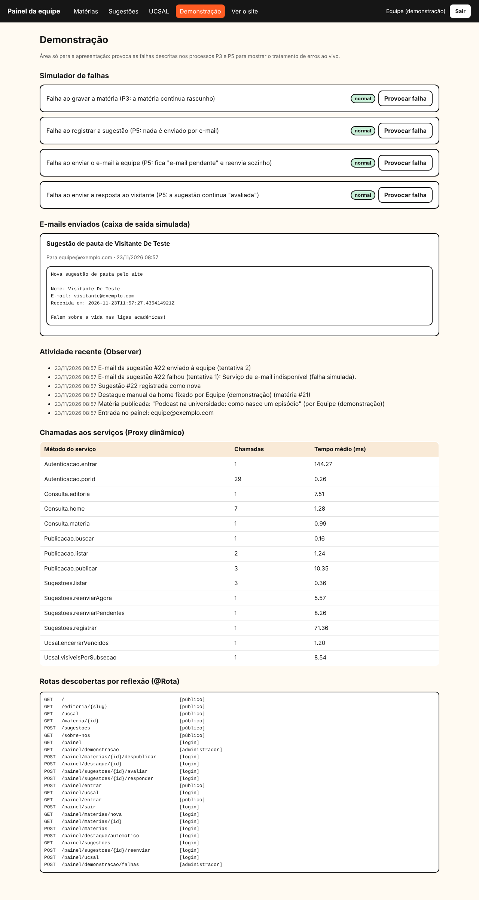 |
| 18 | Versão para celular |  |
